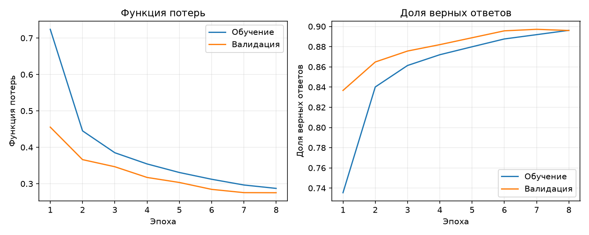
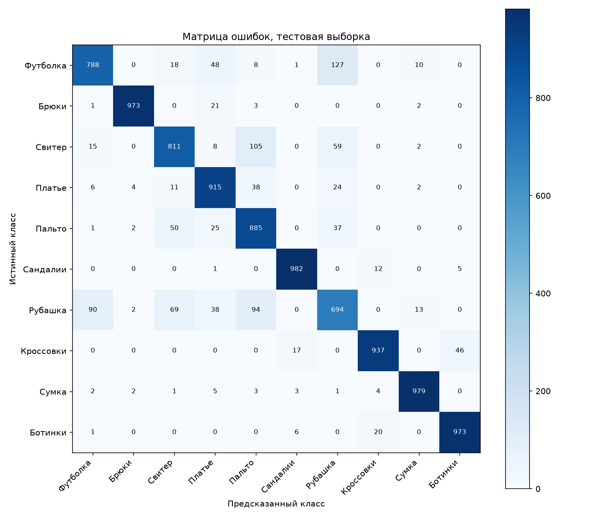
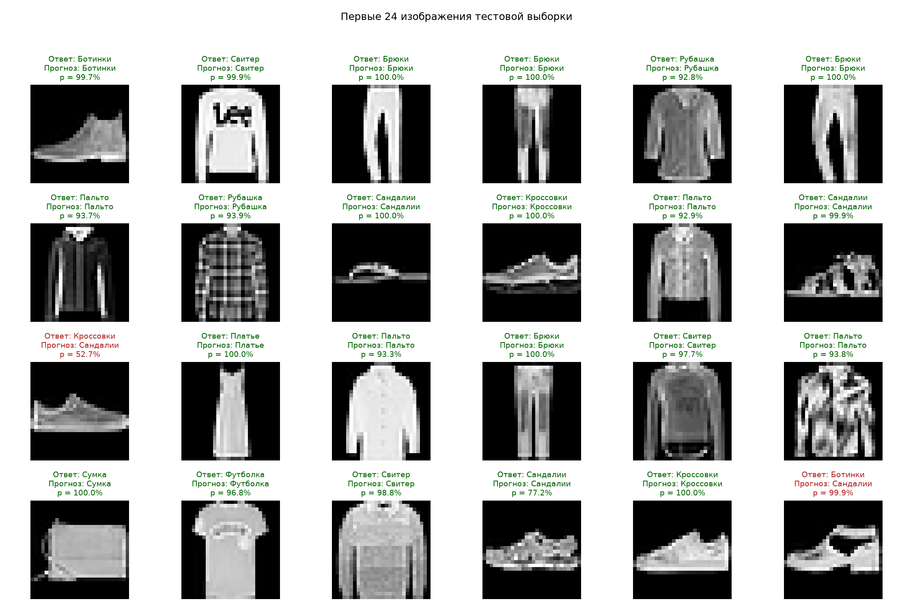
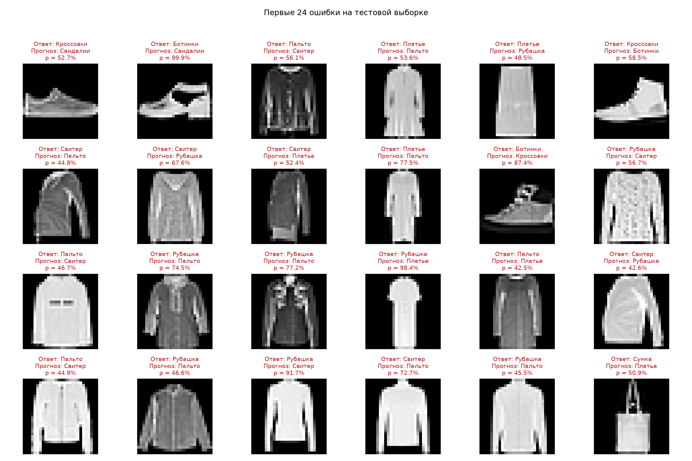

# Лабораторная работа № 1

Дисциплина: «Системы искусственного интеллекта».

Тема: классификация изображений одежды с помощью свёрточной нейронной сети.

## Цель работы

Разработать и обучить модель глубокого обучения на PyTorch для классификации
изображений. Реализовать загрузку датасета с диска и визуализацию предсказаний.

## Постановка задачи

По изображению предмета одежды определить одну из десяти категорий:
футболка, брюки, свитер, платье, пальто, сандалии, рубашка, кроссовки,
сумка, ботинки. Для каждого изображения имеется единственная метка класса,
поэтому решается задача многоклассовой классификации.

## Данные и подготовка

Использован открытый датасет Fashion-MNIST от Zalando. Он содержит
60 000 обучающих и 10 000 тестовых изображений размером 28 × 28 пикселей
в оттенках серого. В каждом классе официальной обучающей выборки
6 000 изображений, тестовой: 1 000.

Скрипт `prepare_data.py` однократно сохраняет файлы IDX в
`data/FashionMNIST/raw/`. Библиотека torchvision проверяет MD5 скачанных
архивов. В `main.py` данные загружаются с параметром `download=False`.
Значения пикселей делятся на 255, получается диапазон [0; 1].
К изображениям добавляется ось канала: тензор одного изображения
имеет форму 1 × 28 × 28.

Официальная обучающая выборка случайно разделяется на 54 000 обучающих
и 6 000 валидационных изображений с seed 42. Валидация нужна для выбора
лучшего состояния модели. Тестовые 10 000 изображений не участвуют
в обновлении весов и выборе состояния модели. Аугментация не применяется.

## Архитектура модели

| Слой | Размер выхода без оси пакета |
| --- | --- |
| Вход | 1 × 28 × 28 |
| Conv2d, 16 фильтров 3 × 3, padding=1; ReLU | 16 × 28 × 28 |
| MaxPool2d, окно 2 × 2 | 16 × 14 × 14 |
| Conv2d, 32 фильтра 3 × 3, padding=1; ReLU | 32 × 14 × 14 |
| MaxPool2d, окно 2 × 2 | 32 × 7 × 7 |
| Flatten | 1568 |
| Linear, ReLU | 64 |
| Dropout, p=0,25 | 64 |
| Linear | 10 |

Всего обучаемых параметров: 105 866.
Свёрточные слои выделяют локальные признаки, пулинг уменьшает размер
карт признаков, полносвязные слои формируют ответ. ReLU добавляет
нелинейность. Dropout используется при обучении для снижения переобучения.

На выходе получаются логиты десяти классов. Функция потерь CrossEntropyLoss
принимает логиты напрямую. Для отображения вероятностей используется softmax,
предсказанный класс выбирается по максимальному значению.

## Обучение

| Параметр | Значение |
| --- | --- |
| Оптимизатор | Adam |
| Скорость обучения | 0,001 |
| Размер обучающего пакета | 128 |
| Размер пакета проверки | 256 |
| Число эпох | 8 |
| Seed | 42 |
| Выбор модели | Минимальная потеря на валидации |
| Лучшая эпоха | 8 |
| Устройство | CPU, 4 потока |

Веса сохраняются в `results/model.pt`. Итоговый тест выполняется
после загрузки выбранного состояния модели. Во время проверки вызывается
`model.eval()`, поэтому Dropout выключен; градиенты не вычисляются.

## Результаты фактического запуска

Обучение выполнено в macOS, Python 3.13.2,
PyTorch 2.14.1. Время цикла обучения с валидацией
и сохранением весов: 90.59 с.
Загрузка данных и итоговые графики в это время не входят.

| Эпоха | Потери, обучение | Точность, обучение | Потери, валидация | Точность, валидация |
| --- | --- | --- | --- | --- |
| 1 | 0.7240 | 73.54% | 0.4554 | 83.67% |
| 2 | 0.4451 | 84.01% | 0.3661 | 86.48% |
| 3 | 0.3851 | 86.14% | 0.3466 | 87.57% |
| 4 | 0.3543 | 87.20% | 0.3172 | 88.20% |
| 5 | 0.3308 | 87.99% | 0.3034 | 88.88% |
| 6 | 0.3122 | 88.76% | 0.2845 | 89.57% |
| 7 | 0.2965 | 89.19% | 0.2755 | 89.72% |
| 8 | 0.2871 | 89.62% | 0.2752 | 89.60% |

Точность рассчитана как количество верных ответов, делённое на общее
количество изображений. Итоговая точность на тесте: **89.37%**,
верных ответов: **8937 из 10 000**. Тестовая потеря: **0.2882**.

Точность отдельных классов ниже означает долю правильно распознанных
изображений среди всех изображений соответствующего истинного класса
(полноту, recall), а не precision.

| Истинный класс | Доля верных ответов |
| --- | --- |
| Футболка | 78.80% |
| Брюки | 97.30% |
| Свитер | 81.10% |
| Платье | 91.50% |
| Пальто | 88.50% |
| Сандалии | 98.20% |
| Рубашка | 69.40% |
| Кроссовки | 93.70% |
| Сумка | 97.90% |
| Ботинки | 97.30% |

В матрице строки соответствуют истинным классам, столбцы предсказанным.
Правильные ответы расположены на главной диагонали. Самые частые
направления ошибок:

- Истинный класс «Футболка», прогноз «Рубашка»: число случаев 127.
- Истинный класс «Свитер», прогноз «Пальто»: число случаев 105.
- Истинный класс «Рубашка», прогноз «Пальто»: число случаев 94.

## Примеры классификации

Показаны первые 24 изображения тестовой выборки без отбора по результату.
Подписи содержат истинную категорию, предсказанную категорию и вероятность
выбранного класса. Верные ответы выделены зелёным, ошибки красным;
текстовые подписи позволяют отличать их без опоры только на цвет.
Вероятность softmax является оценкой сети, её калибровка не проверялась.

Отдельно показаны первые 24 ошибочных предсказания. Сходство силуэтов
разных предметов одежды может объяснять часть ошибок, но причины
каждого решения сети отдельно не исследовались.

## Проверка программы

Выполнены две автоматические проверки (`python -m unittest -v test_main.py`):
форма выхода сети и конечность градиентов; размеры выборок, отсутствие
пересечения обучающих и валидационных индексов и формат входного изображения.
Обе проверки прошли. Проверен повторный запуск с `--evaluate`:
сохранённая модель загружается с диска и воспроизводит итоговые метрики.
Запуск в Windows не проводился; для него приведены команды в README.

## Вывод

Реализована свёрточная нейронная сеть на PyTorch для распознавания
десяти категорий одежды. Датасет загружается с диска. На независимой
тестовой выборке получена точность 89.37%.
Построены графики обучения, матрица ошибок и примеры классификации.
Ошибки между внешне похожими категориями показывают ограничения модели.
Во второй лабораторной можно оценить влияние аугментации на том же
разделении данных.

## Источники

1. [Задание лабораторной работы](https://github.com/ulstu/ml/blob/master/ml_course_ru/assignments/ai_systems2/lab_tasks.md).
2. [Fashion-MNIST, официальный репозиторий](https://github.com/zalandoresearch/fashion-mnist).
3. [Документация PyTorch: Datasets и DataLoaders](https://docs.pytorch.org/tutorials/beginner/basics/data_tutorial.html).
