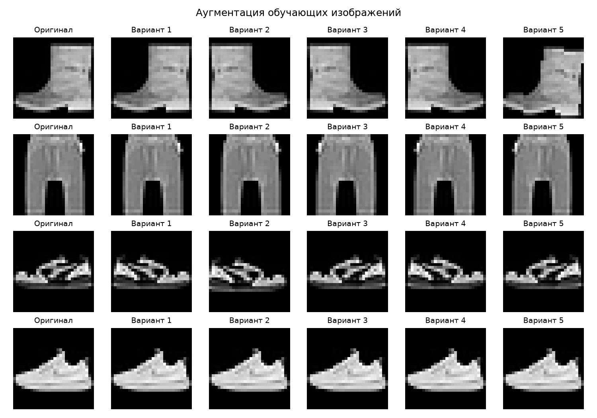
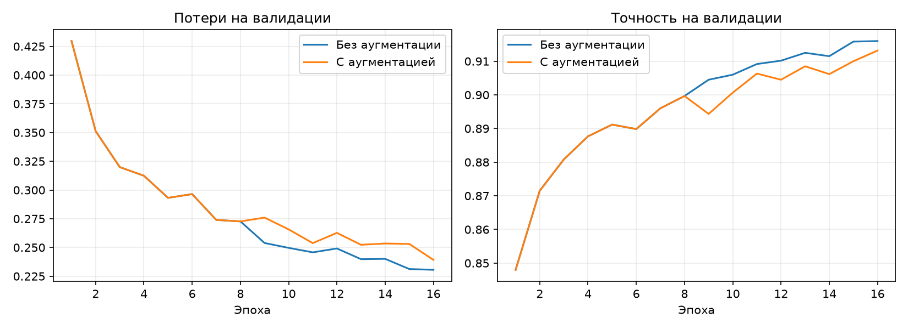
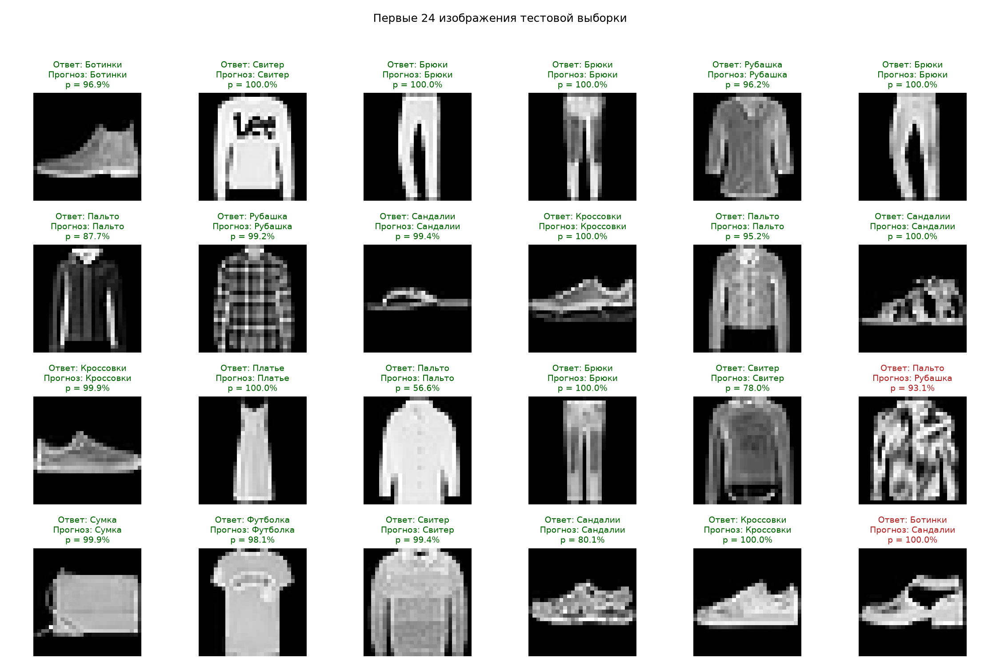
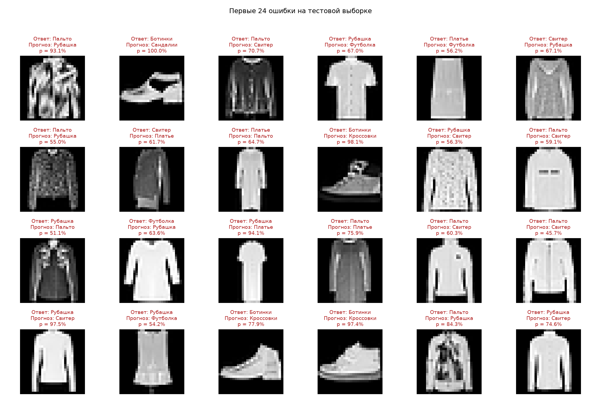
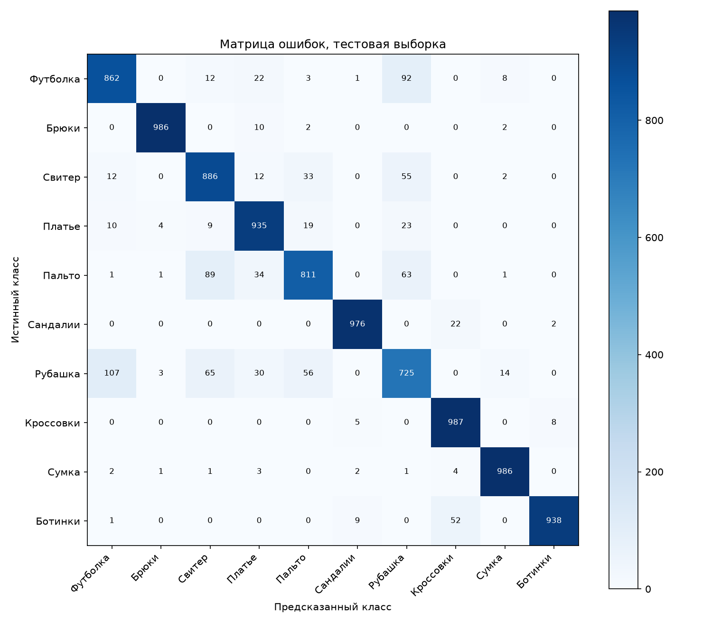

# Лабораторная работа № 2

Дисциплина: «Системы искусственного интеллекта», 7 семестр.

Тема: аугментация данных для классификации изображений одежды.

## Цель и задание

Использовать аугментацию данных для задачи из первой лабораторной работы
и проверить её влияние на точность модели глубокого обучения.
[Задание УлГТУ](https://github.com/ulstu/ml/blob/master/ml_course_ru/assignments/ai_systems2/lab_tasks.md).

## Исходные данные и модель

Использован Fashion-MNIST: 60 000 обучающих и 10 000 тестовых изображений
одежды размером 28×28 в оттенках серого. Данные загружаются с диска,
`download=False`. Значения пикселей переводятся в диапазон [0; 1].
Из официальной обучающей части выделены 54 000 примеров для обучения
и 6 000 для валидации с seed 42. Обе модели используют одинаковые индексы.
Тестовая выборка содержит отдельные 10 000 изображений.

Сохранена CNN из первой лабораторной: две свёртки 1→16→32 с ядром 3×3,
ReLU и MaxPool 2×2, затем Flatten, Linear 1568→64, ReLU,
Dropout 0,25 и Linear 64→10. Число параметров: 105 866.

## Механизмы аугментации

Введён класс `AugmentedDataset`. При обращении к обучающему объекту
с девятой эпохи он применяет композицию преобразований torchvision:

```python
transforms.Compose([
    transforms.RandomHorizontalFlip(p=0.5),
    transforms.RandomApply([
        transforms.RandomAffine(degrees=5, translate=(0.035, 0.035), scale=(0.98, 1.02)),
    ], p=0.25),
])
```

Изображение отражается по горизонтали с вероятностью 0,5, поворачивается
до 5° в любую сторону, сдвигается по каждой оси до 3,5% размера
и масштабируется в пределах 0,98–1,02. Эти три аффинных изменения
применяются совместно с вероятностью 0,25; отражение независимо. Аффинное преобразование использует
стандартную интерполяцию nearest и заполнение фона нулями.
Размер тензора 1×28×28 и метка класса сохраняются. Новые варианты создаются
в памяти при каждом чтении, исходные тензоры не изменяются.

Малые преобразования выбраны для сохранения узнаваемости одежды.
Вертикальное отражение и большие повороты не используются.
Валидация и тест проверяются без случайных преобразований.



## Условия сравнения

Две модели обучены с нуля: `baseline` без аугментации, `augmented` с ней.
В окончательном режиме первые 8 эпох используются исходные изображения,
следующие 8 эпох включают мягкие преобразования. Оптимизатор при переходе
не сбрасывается. Начальные веса совпадают, перед каждым запуском вызывается
`torch.manual_seed(42)`. Порядок объектов задаётся отдельным генератором
DataLoader с seed 42. Аугментация потребляет случайные числа из общего
генератора, поэтому маски Dropout между запусками могут различаться.

| Параметр | Значение |
| --- | --- |
| Число эпох для каждой модели | 16 |
| Оптимизатор | Adam |
| Скорость обучения | 0,001 |
| Функция потерь | CrossEntropyLoss |
| Размер обучающего пакета | 128 |
| Размер проверочного пакета | 256 |
| Устройство | CPU, 4 потока |
| Выбор весов | Минимальная потеря на валидации |

После обучения каждой модели загружаются лучшие веса и выполняется
проверка на исходном тестовом наборе в режиме `eval()` без градиентов.
Тест не используется для выбора эпохи. Настройки аугментации и бюджет
эпох зафиксированы до проверки окончательной модели на тесте.
Предварительно проверялся более сильный вариант: affine для каждого
изображения, сдвиг 7%, масштаб 0,95–1,05. Его лучший validation loss
0,2767 оказался хуже baseline (0,2306), поэтому преобразования ослаблены.
История этой проверки сохранена в `experiments/strong/`.
Таким образом, настройки выбирались с учётом валидации; это не полностью
слепое сравнение заранее единственной конфигурации.
Второй предварительный вариант, мягкая аугментация с первой эпохи,
дал лучший validation loss 0,2423 и также уступил baseline. После этого
проверен режим 8 исходных + 8 аугментированных эпох; он является
окончательным вариантом исходника. Второй предварительный запуск
сохранён в `experiments/mild/`. Всего проверено три режима аугментации.

## Фактические результаты

Эксперимент выполнен локально в macOS; Windows не проверялась.
Python 3.13.2, PyTorch 2.14.1.

| Показатель | Без аугментации | С аугментацией |
| --- | --- | --- |
| Лучшая эпоха по validation loss | 16 | 16 |
| Точность на тесте | 91.19% | 90.92% |
| Потери на тесте | 0.2526 | 0.2506 |
| Время обучения, с | 172.92 | 201.42 |

Изменение точности с аугментацией: **-0.27 процентного пункта**.
В первой работе сохранён результат 89,37% после 8 эпох. Прямое сравнение
только с ним смешивало бы влияние аугментации и увеличения числа эпох,
поэтому основной результат сравнивается с новым `baseline`.

### Валидация по эпохам

| Эпоха | Точность без аугм. | Точность с аугм. | Потери без аугм. | Потери с аугм. |
| --- | --- | --- | --- | --- |
| 1 | 84.80% | 84.80% | 0.4296 | 0.4296 |
| 2 | 87.15% | 87.15% | 0.3512 | 0.3512 |
| 3 | 88.08% | 88.08% | 0.3199 | 0.3199 |
| 4 | 88.77% | 88.77% | 0.3124 | 0.3124 |
| 5 | 89.12% | 89.12% | 0.2932 | 0.2932 |
| 6 | 88.98% | 88.98% | 0.2964 | 0.2964 |
| 7 | 89.60% | 89.60% | 0.2740 | 0.2740 |
| 8 | 89.97% | 89.97% | 0.2727 | 0.2727 |
| 9 | 90.45% | 89.43% | 0.2539 | 0.2760 |
| 10 | 90.60% | 90.07% | 0.2497 | 0.2657 |
| 11 | 90.92% | 90.63% | 0.2458 | 0.2538 |
| 12 | 91.02% | 90.45% | 0.2491 | 0.2627 |
| 13 | 91.25% | 90.85% | 0.2398 | 0.2523 |
| 14 | 91.15% | 90.62% | 0.2401 | 0.2535 |
| 15 | 91.58% | 91.00% | 0.2312 | 0.2531 |
| 16 | 91.60% | 91.32% | 0.2306 | 0.2392 |



### Доля верных ответов по классам на тесте

В каждом классе тестовой части по 1 000 изображений. Указанная доля
равна recall соответствующего класса: верные ответы / все объекты класса.

| Класс | Без аугментации | С аугментацией |
| --- | --- | --- |
| Футболка | 83.90% | 86.20% |
| Брюки | 98.20% | 98.60% |
| Свитер | 84.00% | 88.60% |
| Платье | 94.00% | 93.50% |
| Пальто | 85.10% | 81.10% |
| Сандалии | 98.10% | 97.60% |
| Рубашка | 76.60% | 72.50% |
| Кроссовки | 97.70% | 98.70% |
| Сумка | 98.40% | 98.60% |
| Ботинки | 95.90% | 93.80% |

### Примеры предсказаний и ошибок







## Проверки и воспроизведение

Три автоматических теста прошли: аугментация меняет изображения,
сохраняет форму и метки и не изменяет источник; выборки не пересекаются,
валидация и тест остаются исходными; сеть обновляет веса при обучении
и выдаёт десять логитов на объект. Дополнительно готовые веса повторно
загружены командой `python main.py --evaluate` с проверкой совпадения метрик.

Исходники: `main.py`, `prepare_data.py`, `test_main.py`.
Команды для Windows приведены в `README.md`, история запусков в
`training.log`, числовые результаты в `results/comparison.json`.
В `Защита.md` приведены объяснения основных решений.

## Вывод

Реализована аугментация обучающих изображений Fashion-MNIST и выполнено
сравнение двух одинаковых CNN при равном числе эпох. В этом запуске
тестовая точность снизилась: 91.19% → 90.92%
(-0.27 п.п.). Результат относится к одному seed и данной конфигурации;
повторения с несколькими seed и оценка статистической устойчивости не выполнялись.
