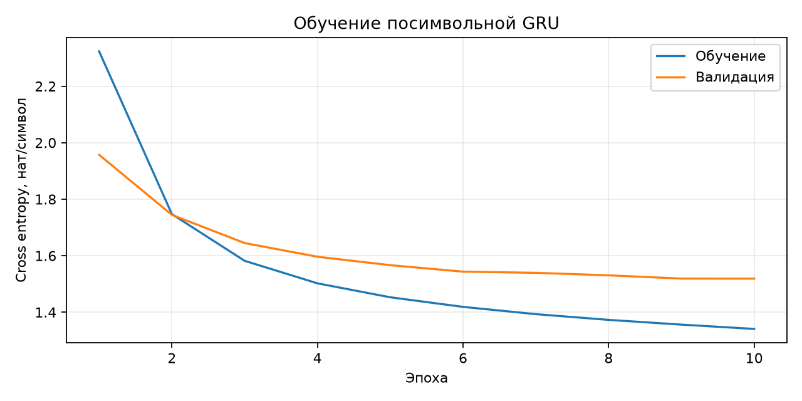

# Лабораторная работа № 3. Генерация текста

## Цель
Разработать и обучить модель генерации текста по выбранному датасету.

## Реализация
Tiny Shakespeare: 1115394 символов, словарь 65 символов.
Последовательное разбиение 80/10/10%: [892315, 111539, 111540].
Окна по 100 символов, целевой текст сдвинут на один символ.
Окон в частях: [8923, 1115, 1115]; неполные остатки не используются.
Embedding(65,64) → GRU(64,256) → Linear(256,65), 268161 параметров.
Adam 0,002, batch size 64, clipping 1,0; CPU 4 потока, seed 42.
10 эпох, лучшие веса по validation loss, тест после выбора.

## Фактические результаты
Начальный validation loss: 4.1738.
Лучшая эпоха: 10.
Время обучения: 102.94 с.
Test cross entropy: 1.7145 нат/символ.
Test perplexity: 5.554.
Python 3.13.2, PyTorch 2.14.1, macOS CPU.



| Эпоха | Train loss | Validation loss |
| --- | --- | --- |
| 1 | 2.3235 | 1.9572 |
| 2 | 1.7472 | 1.7446 |
| 3 | 1.5818 | 1.6447 |
| 4 | 1.5022 | 1.5963 |
| 5 | 1.4528 | 1.5665 |
| 6 | 1.4188 | 1.5435 |
| 7 | 1.3931 | 1.5394 |
| 8 | 1.3728 | 1.5304 |
| 9 | 1.3560 | 1.5190 |
| 10 | 1.3408 | 1.5188 |

## Примеры генерации
Затравка ROMEO:\n, seed 42, 600 новых символов.

### Температура 0.5

```text
ROMEO:
What shall be discontented with a balland,
Because I be a breast and the dreams are man.

GLOUCESTER:
This is the earth the precious all the flesh,
Who be a prince and desperate to be both.

COMINIUS:
As he should see them are but looks,
Which shall be false and with course.

BENVOLIO:
Good many abroad.

KING EDWARD IV:
I have a blood of the dogs of the houses,
Where is the world of our son, a sease.

CORIOLANUS:
What, there is the time and lights are not the point.

MENENIUS:
Good more, and he did well;
Where is the last, and he shall be pardon as we do smoon to the other head
Where he is do 
```

### Температура 0.8

```text
ROMEO:
Yes, thou art day: whom the read, our deep?

FRIAR LAURENCE:
For a hard!

KING EDWARD IV:
Well, no, but thou be any sight
Hath conclude no crull cold tebly known but
The way with your both.

COMINIUS:
As he should see me out;
Nor for a ward
They have done the am with course?

QUEEN ELIZABETH:
Tho breath that valiant cousin Beckent,
Would beat of mother's souls,
Where riddly,-honour to his father's is
With an up to this virtues night?
How now, gentle say 'gainst this neight in judgit was,
He want thy soul's bastards down, and party,
He shall be underction, my night gorded,
When thou see him dot
```

### Температура 1.1

```text
ROMEO:
Yes, thou art day: whom if your spothedness.

He he deserve.
For a hird!

KING EDWARD IV:
Well, no, but in their
ceasion famented: that never leave,
Woebly have so feel, when if the stand
One peace? what?

GLOUCETES:
Tut, and then like turn
To sin my difform and were course?

QUEEN ELIZABETH:
Tho breast begat fall 'ndoubs to his blood, cleaste
But thoughts by passed
Bringtho-hood, hench word years,
Which want the heads, his as night?
How now, gentle danger boot: find
Must be beary thee welconerent me drust;
We marry vlight, that you make an armugh.
Come, let night gird as his, tongue.

DUCESTE
```

## Проверки и вывод
Три автоматических теста прошли; повторная загрузка весов сохранила метрики.
Модель усвоила локальные закономерности текста, но допускает искажённые
слова, повторы и смысловые ошибки. Perplexity не оценивает связность.
Один seed; Windows не проверена. Инструкция и источники приведены в README.md.
