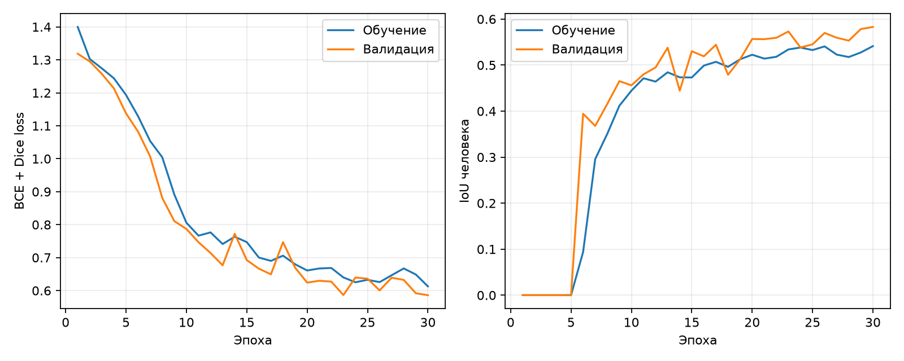
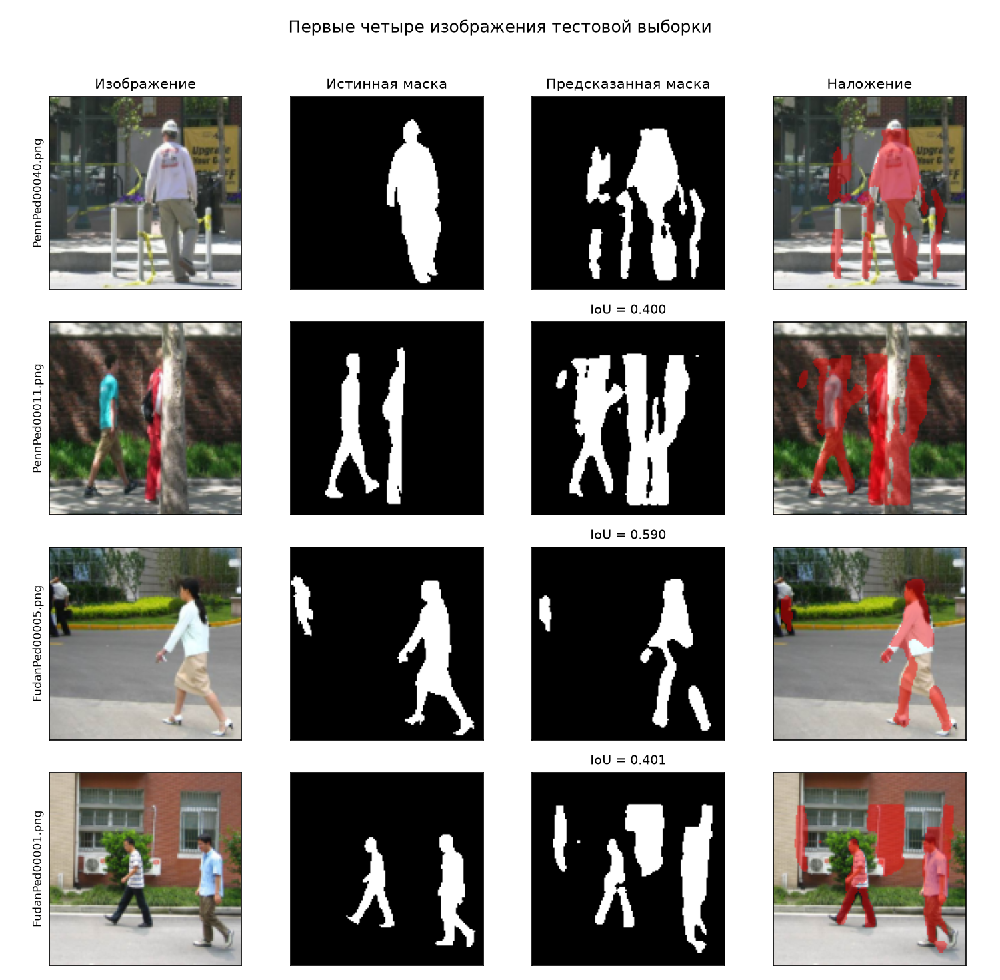
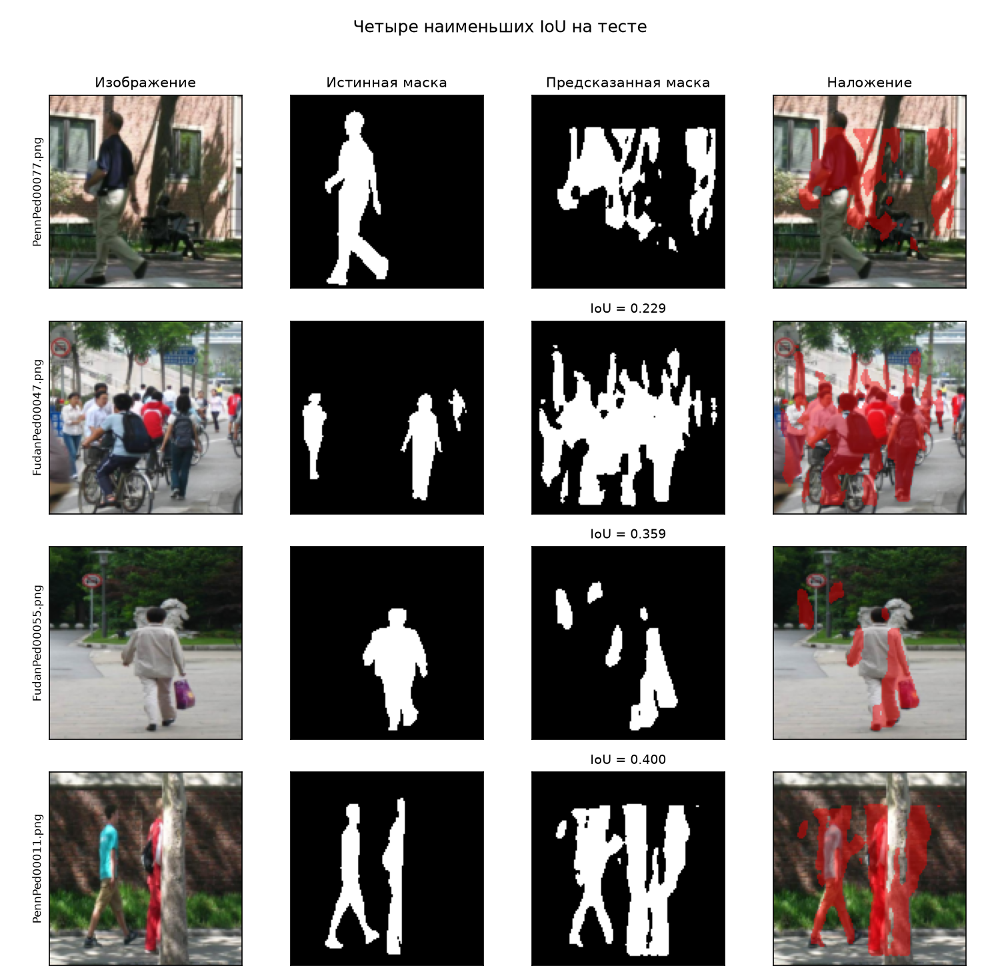

# Лабораторная работа № 4. Сегментация изображений

## Цель и реализация
Обучить модель выделять пешеходов на фотографиях.
Penn-Fudan: 170 изображений с разметкой; split 120/25/25 с seed 42.
Бинарные маски: 0 — фон, 1 — человек (все экземпляры объединены).
Размер 128×128, RGB bilinear, маски nearest; пропорции изменяются.
В обучении совместное горизонтальное отражение с вероятностью 0,5.
Компактная U-Net 16/32/64 каналов, 117041 параметров.
Adam 0,001, batch size 8, BCE + soft Dice loss, 30 эпох.
Модель выбрана по наибольшему глобальному IoU на валидации,
порог sigmoid 0,5 зафиксирован до теста.

## Фактические результаты
Лучшая эпоха: 30; время обучения: 139.19 с.
Валидационный IoU лучших весов: 0.5829.
Тестовые IoU и Dice суммируют TP/FP/FN по всей выборке.

| Показатель | U-Net | Всё фон |
| --- | --- | --- |
| IoU человека | 0.5086 | 0 |
| Dice человека | 0.6743 | 0 |
| Pixel accuracy | 89.40% | 85.98% |

Средний IoU по изображениям: 0.5180;
средний Dice: 0.6696; test loss: 0.6363.

## Визуализация
Первые четыре тестовых файла, без отбора по качеству:

Четыре наименьших IoU на тесте:

## История обучения
| Эпоха | Train loss | Val loss | Val IoU |
| --- | --- | --- | --- |
| 1 | 1.3998 | 1.3184 | 0.0000 |
| 2 | 1.3024 | 1.2949 | 0.0000 |
| 3 | 1.2740 | 1.2574 | 0.0000 |
| 4 | 1.2439 | 1.2131 | 0.0000 |
| 5 | 1.1935 | 1.1377 | 0.0004 |
| 6 | 1.1287 | 1.0819 | 0.3944 |
| 7 | 1.0535 | 1.0065 | 0.3678 |
| 8 | 1.0045 | 0.8812 | 0.4156 |
| 9 | 0.8915 | 0.8107 | 0.4652 |
| 10 | 0.8058 | 0.7870 | 0.4561 |
| 11 | 0.7666 | 0.7468 | 0.4800 |
| 12 | 0.7765 | 0.7140 | 0.4948 |
| 13 | 0.7413 | 0.6766 | 0.5378 |
| 14 | 0.7633 | 0.7723 | 0.4444 |
| 15 | 0.7470 | 0.6925 | 0.5301 |
| 16 | 0.7002 | 0.6664 | 0.5191 |
| 17 | 0.6901 | 0.6494 | 0.5443 |
| 18 | 0.7060 | 0.7470 | 0.4790 |
| 19 | 0.6799 | 0.6696 | 0.5125 |
| 20 | 0.6610 | 0.6242 | 0.5567 |
| 21 | 0.6670 | 0.6297 | 0.5564 |
| 22 | 0.6686 | 0.6272 | 0.5593 |
| 23 | 0.6399 | 0.5865 | 0.5732 |
| 24 | 0.6252 | 0.6396 | 0.5383 |
| 25 | 0.6327 | 0.6361 | 0.5451 |
| 26 | 0.6257 | 0.6006 | 0.5700 |
| 27 | 0.6466 | 0.6390 | 0.5595 |
| 28 | 0.6672 | 0.6324 | 0.5533 |
| 29 | 0.6488 | 0.5919 | 0.5783 |
| 30 | 0.6129 | 0.5860 | 0.5829 |

## Проверки и вывод
Четыре теста прошли; повторная загрузка весов дала те же метрики.
Запуск: macOS, Python 3.13.2, PyTorch 2.14.1, CPU 4 потока.
Windows не проверялась. Модель выделяет людей, но ошибается на части
фона и границах. Метрики относятся к 128×128, одному seed и случайному
разбиению по изображениям. Похожие сцены могут попасть в разные части;
перенос на новые условия не подтверждён. Источники и команды в README.md.
